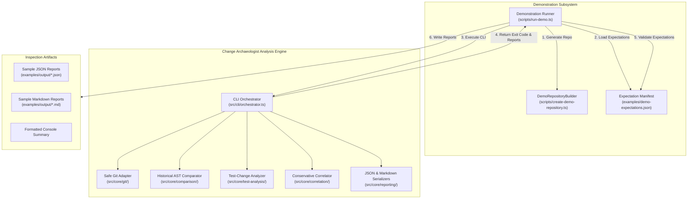

# Change Archaeologist — Demonstration Environment Architecture

**Document Status:** Complete & Verified  
**Date:** November 4, 2026  
**System:** Change Archaeologist Demo Harness & End-to-End Validation Engine

---

## 1. Architectural Purpose & Design Goals

The demonstration architecture provides an empirical, reproducible, and self-contained environment to validate Change Archaeologist's static analysis engine on demand. Rather than pointing evaluators to external repositories that may change, move, or require network access, the demonstration subsystem programmatically generates a synthetic, fully deterministic Git repository with realistic code and test histories.

### Key Architectural Invariants
1. **100% Local & Network-Independent:** Operates without outbound network requests, external package dependencies, or cloud services.
2. **Strict Host Workspace Isolation:** Synthetic repositories are created in isolated target paths (e.g. `examples/demo-repository/` or `os.tmpdir()`); the host project repository is never touched or mutated.
3. **Deterministic Commit Metadata:** Authors, committers, and timestamps (`GIT_AUTHOR_DATE`, `GIT_COMMITTER_DATE`) are fixed, ensuring reproducible commit hashes and tags (`base`, `head`).
4. **Epistemic Integrity:** Manifest-driven expectation validation asserts that the tool strictly adheres to `OBSERVED -> INFERRED -> UNKNOWN` rules without fabricating runtime certainty.

---

## 2. Component Architecture

---

## 3. Data & Artifact Lifecycles

### 3.1 Repository Generation (`DemoRepositoryBuilder`)
The generator initializes a pristine Git repository using child process execFile (`shell: false`). It enforces:
- `core.autocrlf = false` to eliminate line-ending variance across Windows and Linux.
- `commit.gpgSign = false` to prevent interactive GPG agent prompts.
- `GIT_TERMINAL_PROMPT = 0` and `GIT_OPTIONAL_LOCKS = 0` to ensure non-blocking, clean operations.
- Two immutable commits:
  - **Commit 1 (Tag `base`):** Initial release `v1.0.0` at `2026-01-01T12:00:00Z`.
  - **Commit 2 (Tag `head`):** Refactored release `v1.1.0` at `2026-01-02T12:00:00Z`.

### 3.2 Predefined Expectations Manifest (`demo-expectations.json`)
The manifest establishes ground truth **prior** to execution. Each scenario specifies:
- `targetFilePath`: Repository-relative production file.
- `targetFunctionName`: Declared function identifier.
- `companionTestFiles`: Optional companion test files.
- `expectedExitCode`: Standard CLI exit code (`0` for success, `1` for incomplete analysis).
- `expectedReportStatus`: Domain status (`COMPLETED_WITH_FINDINGS`, `INCOMPLETE_FUNCTION_MISSING`).
- `expectedStructuralRules`: AST change rule IDs (`RULE_GUARD_REMOVED`, `RULE_CONDITIONAL_MODIFIED`, etc.).
- `expectedCorrelationStatus`: Syntactic proximity level (`STRONG`, `WEAK`).
- `forbiddenClaims`: Phrases that must never appear in CLI output (e.g. *"proves a regression"*, *"bug introduced"*).

### 3.3 Verification & Validation Pipeline (`runDemonstration`)
For each scenario:
1. **JSON Execution:** Runs `runCli` with `--format json`. Captures numeric exit code, stdout, and stderr.
2. **Schema & Referential Integrity Audit:** Validates stdout with `validateAnalysisReport()`.
3. **Expectation Comparison:** Verifies exit codes, status strings, detected AST rules, and correlation items against the manifest.
4. **Epistemic Boundary Audit:** Scans output to guarantee no forbidden claims appear.
5. **Markdown Execution:** Re-runs with `--format markdown` to verify heading escaping, table formatting, and section completeness.
6. **Report Emission:** Writes sample `.json` and `.md` artifacts into `examples/output/`.

---

## 4. Scenario Matrix

| Scenario | Production File | Target Function | Test File | Expected Change | Rule ID | Expected Correlation |
| :---: | :--- | :--- | :--- | :--- | :--- | :---: |
| **A** | `src/auth.ts` | `processPayment` | *None* | Guard clause removed | `RULE_GUARD_REMOVED` | *None* |
| **B** | `src/access.ts` | `authorizeUser` | *None* | Conditional operator mutated (`&&` to `\|\|`) | `RULE_CONDITIONAL_MODIFIED` | *None* |
| **C** | `src/config.ts` | `loadConfig` | *None* | Throw replaced by fallback `{}` return | `RULE_THROW_TO_RETURN_CONVERSION` | *None* |
| **D** | `src/order.ts` | `calculateDiscount` | `tests/order.test.ts` | Assertion modified from 10 to 15 | `ASSERTION_MODIFIED_OR_REWRITTEN` | *None* |
| **E** | `src/order.ts` | `calculateDiscount` | `tests/order.test.ts` | Coexisting return change and assertion modification | `RULE_RETURN_MODIFIED` | `STRONG` (`POTENTIALLY_RELATED_ASSERTION_MODIFIED`) |
| **F** | `src/legacy.ts` | `deprecatedHelper` | *None* | Function deleted in HEAD | *None* (Exit code 1) | `INCOMPLETE_FUNCTION_MISSING` |

---

## 5. Security & Isolation Boundaries

- **Subprocess Safety:** All Git invocations use `execFileSync` / `execFile` passing argument arrays directly to the OS kernel without shell expansion.
- **Directory Protection:** The demonstration repository is placed in `examples/demo-repository/` (ignored in `.gitignore`) or temporary directories. The main repository is never altered.
- **Cross-Platform Consistency:** Verified on both Windows and Linux in GitHub Actions.

