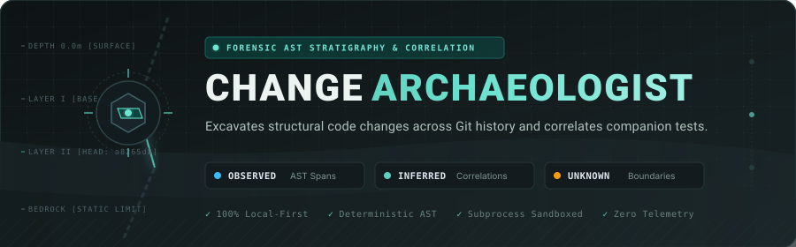
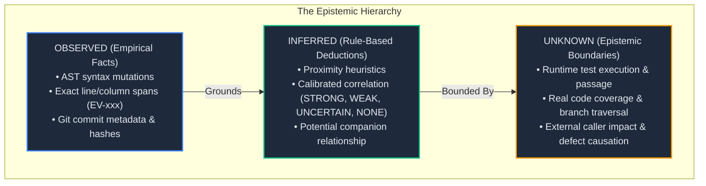
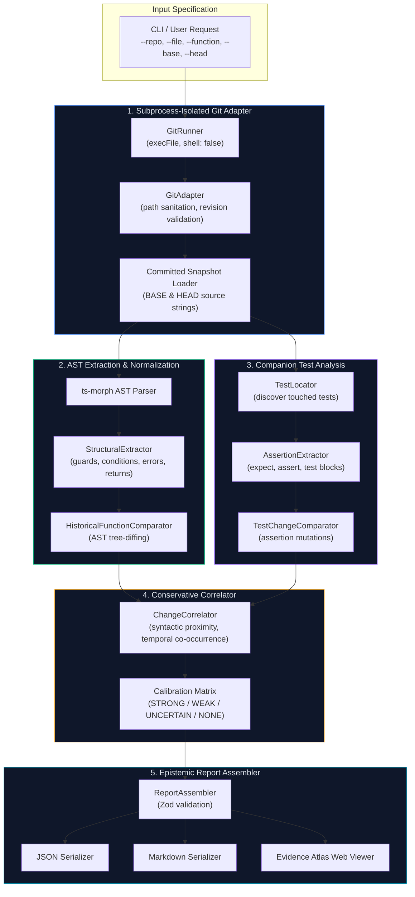

<div align="center">

<p align="center">
  
</p>

# Change Archaeologist

**Forensic Git AST Comparison & Companion Test Correlation for JavaScript & TypeScript**

[](https://github.com/rknishanth152-lgtm/change-archaeologist/actions/workflows/ci.yml)
[](https://github.com/rknishanth152-lgtm/change-archaeologist)
[-blue.svg?style=flat-square)](https://github.com/rknishanth152-lgtm/change-archaeologist)
[](LICENSE)
[](package.json)
[](tsconfig.json)
[](#security-sandboxing--zero-trust-architecture)

<p align="center">
  <a href="#the-problem-why-change-archaeologist">The Problem</a> •
  <a href="#the-epistemic-bridge">The Epistemic Bridge</a> •
  <a href="#the-dig-interactive-evidence-atlas">The Dig & Web Viewer</a> •
  <a href="#quickstart-in-60-seconds">Quickstart</a> •
  <a href="#architecture--pipeline">Architecture</a> •
  <a href="#the-6-forensic-demonstration-scenarios">Forensic Scenarios</a> •
  <a href="#cli-reference">CLI Reference</a> •
  <a href="#comparison">Comparison</a>
</p>

</div>

---

> **The Bedrock Principle:**  
> *Show the evidence. Label the inference. Admit what is unknown.*  
> Static analysis can prove observed structural changes and syntactic co-occurrence between commits. It cannot, by itself, prove runtime test execution, test passage, actual coverage, or defect causation.

---

## The Problem: Why Change Archaeologist?

Modern software development relies heavily on Git for version tracking and CI pipelines for regression detection. However, our tools leave critical blind spots during code reviews, postmortems, and refactoring audits:

| Traditional Tool | What It Sees | What It Misses |
|---|---|---|
| **`git diff`** | Formatted text lines with `+` and `-` markers. | Oblivious to syntax. Line wraps, reordered imports, and formatting changes drown out actual control-flow alterations. |
| **Code Coverage (c8/Istanbul)** | Lines executed during a test run. | Measures execution, not assertion. A test can execute 100% of a function's lines without asserting anything about modified guard logic. |
| **AI Reviewers** | Probabilistic code summaries. | Prone to hallucinations, statistical optimism, and guessing intent without mathematical proof. |

**Change Archaeologist** replaces diff noise and probabilistic guesses with **deterministic, AST-level forensic code archaeology**:

1. **Syntactic Granularity:** Parses TypeScript/JavaScript ASTs across any two historical Git revisions (`BASE` vs `HEAD`) to isolate structural changes inside a specific named function (safety checks, conditions, thrown errors, and return values).
2. **Companion Test Excavation:** Detects test files touched in the same commit, traces individual test declarations, and extracts added, removed, or rewritten assertions (`expect()`, `assert()`).
3. **Calibrated Correlation:** Maps structural mutations to companion test assertion changes using conservative, rule-based heuristics without conflating correlation with causation.
4. **Epistemic Honesty:** Categorizes every finding into what was observed as fact, what is inferred as rule-backed interpretation, and what remains unknowable without runtime execution.

---

## The Epistemic Bridge

Every analysis produced by Change Archaeologist strictly segregates findings into three epistemic tiers:



### Correlation Calibration

When correlating a production AST change with companion test changes, the relationship is assigned one of four strict classifications:

| Status | Meaning | Visual Shaft Representation |
|:---:|---|---|
| **`STRONG`** | High syntactic alignment: assertion expressions directly reference modified variables, guards, or function signatures. | **Solid verdigris line** drilled from fault to assertion. |
| **`WEAK`** | Temporal co-occurrence: assertion or test block changed in the same commit within a companion test file, but without direct syntactic binding. | **Dashed mineral line**. |
| **`UNCERTAIN`** | Ambiguous alignment: multiple identical test descriptions, anonymous callbacks, or unresolved helper delegation. | **Dotted amber line**. |
| **`NONE`** | Production code changed, but companion test assertions were unmodified or deleted entirely. | **Hollow line ending in open ground**. |

---

## The Dig: Interactive Evidence Atlas

Change Archaeologist includes a local-first, interactive forensic analysis viewer called **Evidence Atlas**. Built with React 19, Vite, Tailwind CSS v4, Monaco Editor, and `@xyflow/react`.

```
======================================================================================
  CHANGE ARCHAEOLOGIST  [Scenario E] ▾  [Guide]  [Import JSON]  [Theme: Dark]
  calculateDiscount  •  src/order.ts  •  9a8bf4e → a8265d8  •  [COMPLETED_WITH_FINDINGS]
======================================================================================
  [ THE DIG ]             [ CODE & TESTS ]             [ FINDINGS ]
--------------------------------------------------------------------------------------
  EXCAVATION CROSS-SECTION (THE DIG)              RESIZABLE DETAIL INSPECTOR
  +--------------------------------------------+  +----------------------------------+
  |  BASE (9a8bf4e)            HEAD (a8265d8)  |  | MONACO CODE COMPARISON           |
  |  ----------------------------------------  |  | [Side-by-Side] [Unified]         |
  |  L1: export function       L1: export ...  |  | L14:C3-L16:C20 (EV-001)          |
  |  ... (compressed runs) ...                 |  | -------------------------------- |
  |  L14: if (!user)           L14: // check   |  | - if (!user) throw Error();      |
  |  ========================================  |  | + // safety check removed        |
  |  FAULT: Safety check removed (EV-001)      |  | -------------------------------- |
  |     \                                      |  | EVIDENCE CORRELATION             |
  |      \ SHAFT: NONE (No test assertion)     |  | • Status: NONE                   |
  |       \                                    |  | • Attention: REVIEW FIRST        |
  |        v [Open Ground]                     |  | • Question: Was test updated?    |
  |  ~~~~~~~~~~~~~~~~~~~~~~~~~~~~~~~~~~~~~~~~  |  |                                  |
  |  BEDROCK: WHAT STATIC ANALYSIS CANNOT SEE  |  |                                  |
  +--------------------------------------------+  +----------------------------------+
```

### Key Viewer Features

1. **The Dig (Excavation Cross-Section):**
   - **Rock Layers:** Displays actual source lines for the target function in `BASE` (left) and `HEAD` (right). Long unchanged code runs are dynamically compressed.
   - **Faults:** Visual seismic fault-lines connecting matching or altered AST statements. Added or removed statements pinch cleanly to a single origin or destination.
   - **Shafts:** Correlation conduits drilled from faults across to companion test assertions.
   - **Bedrock ("Never Dug"):** A distinct hatched foundation band visualizing the epistemic boundary. Shafts never penetrate bedrock.
2. **Code & Tests Workspace:**
   - Full-width side-by-side or unified Monaco diff inspection with syntax highlighting and line coordinate anchors (`L14:C3-L16:C20`).
   - Deep-linked evidence stepper (`< Prev Evidence Next >`) navigating directly to AST mutation spans.
3. **Findings View:**
   - Structured triage cards categorized by review attention (`Review First`, `Worth a Look`, `Informational`).
   - Strict separation into Observed Facts, Inferred Hypotheses, and Open Epistemic Questions.
4. **Report Intake & Start Screen:**
   - Zero-configuration drag-and-drop JSON report intake with real-time Zod schema validation.
   - Preset selector for one-click exploration of the 6 demonstration scenarios.
   - 20 MB browser memory exhaustion ceiling (`MAX_REPORT_FILE_BYTES`) to prevent tab freezing.
5. **Universal Accessibility (WCAG 2.2 AA):**
   - Dedicated **Accessible Table View** providing complete keyboard navigation, roving tabindexes, screen-reader descriptions, and focus trapping.
   - Dual mineral color themes (Light / Dark) designed with strict 4.5:1 text contrast ratios.
   - Self-hosted IBM Plex Sans and IBM Plex Mono fonts with zero third-party web font calls.

---

## Quickstart (in <60 seconds)

### Prerequisites

- **Node.js**: `^20.0.0 || ^22.0.0 || ^24.0.0`
- **Git**: `^2.30.0` available on your system `PATH`

### 1. Clone & Install

```bash
git clone https://github.com/rknishanth152-lgtm/change-archaeologist.git
cd change-archaeologist
npm install
```

### 2. Run the End-to-End Demonstration

Experience Change Archaeologist on a synthetic, realistic Git history with zero repository setup:

```bash
npm run demo
```

This compiles the project, generates an isolated synthetic Git repository in `examples/demo-repository/`, runs analysis across 6 forensic scenarios, verifies 100% agreement with analytical expectations, and outputs reports to `examples/output/`.

### 3. Launch the Evidence Atlas Web Viewer

```bash
# Start Vite development server at http://localhost:5173
npm run dev

# Or build and launch the production viewer
npm run build
npm run preview
```

Click **Demo Preset** to explore preloaded scenarios, or drop in any report generated from the CLI.

---

## Architecture & Pipeline

Change Archaeologist executes as a deterministic, unidirectional data pipeline:



---

## The 6 Forensic Demonstration Scenarios

Change Archaeologist is calibrated against 6 canonical software evolution patterns:

```
┌──────────┬────────────────────────────────────────────┬─────────────────────────────┬───────────────────────────┐
│ Scenario │ Pattern Description                        │ Production Change           │ Companion Test Status     │
├──────────┼────────────────────────────────────────────┼─────────────────────────────┼───────────────────────────┤
│ A        │ Safety Check (Guard Clause) Removal        │ processPayment in auth.ts   │ Assertion modified        │
│ B        │ Conditional Expression Mutation (&& to ||) │ authorizeUser in access.ts  │ Assertion modified        │
│ C        │ Throw-to-Return Control Flow Conversion    │ loadConfig in config.ts     │ Assertion modified        │
│ D        │ Companion Test Addition                    │ calculateDiscount in order. │ New assertion added       │
│ E        │ Production Change with Unmodified Test     │ calculateDiscount in order. │ Test file left UNTOUCHED  │
│ F        │ Missing / Deleted Function                 │ deprecatedHelper in legacy. │ Function removed in HEAD  │
└──────────┴────────────────────────────────────────────┴─────────────────────────────┴───────────────────────────┘
```

- **Scenario A (Guard Removal):** Detects when a safety check (`if (!user) throw Error()`) is dropped, locating the exact span where defensive programming was removed.
- **Scenario B (Operator Mutation):** Detects boolean logic inversions (`role === 'admin' && active` changed to `||`), flagging critical authorization shifts.
- **Scenario C (Throw-to-Return):** Identifies control-flow shifts where error handling switched from exceptional throws to nullable/default return values.
- **Scenario D (Test Addition):** Demonstrates positive correlation where new business logic is accompanied by an added assertion in the companion test.
- **Scenario E (Regression Hazard):** **The most common source of production bugs.** Production logic was modified, but the companion test file was left completely unchanged. Change Archaeologist highlights the correlation as `NONE` and raises a `REVIEW FIRST` warning.
- **Scenario F (Missing Function):** Demonstrates honest epistemic boundaries. Rather than guessing or hallucinating changes for a function that no longer exists, it issues a structured `INCOMPLETE_FUNCTION_MISSING` report.

---

## CLI Reference

### Command Syntax

```bash
node bin/change-archaeologist.js analyze [OPTIONS]
```

### Required Options

| Option | Flag | Description | Example |
|---|:---:|---|---|
| `--repo <path>` | `-r` | Path to the local Git repository | `--repo .` or `--repo "/path/to/project"` |
| `--file <path>` | `-f` | Repository-relative path to source file | `--file src/auth.ts` |
| `--function <name>` | `-fn`| Target function or method name | `--function processPayment` |
| `--base <rev>` | `-b` | Base Git revision (commit SHA, branch, tag) | `--base main~1` or `--base v1.0.0` |
| `--head <rev>` | | Head Git revision (commit SHA, branch, tag) | `--head main` or `--head feature-branch` |

### Optional Configuration

| Option | Flag | Default | Description |
|---|:---:|:---:|---|
| `--test-file <path>` | `-t` | *(auto-detect)* | Companion test file to inspect (repeatable for multiple tests) |
| `--format <type>` | | `markdown` | Report format: `markdown` or `json` |
| `--output <path>` | `-o` | *(stdout)* | Destination file path for generated report |
| `--force` | | `false` | Overwrite destination file if it already exists |
| `--max-file-size-mb`| | `2` | Maximum source file size in MB before rejecting (`BLOB_SIZE_EXCEEDED`) |
| `--max-git-output-mb`| | `10`| Git runner `maxBuffer` ceiling in MB |
| `--git-timeout-ms` | | `10000` | Subprocess timeout limit in milliseconds |
| `--verbose` | | `false` | Enable verbose diagnostic logging |
| `--help` | `-h` | | Display help message and exit |
| `--version` | `-v` | | Display version number and exit |

### Documented Exit Codes

Change Archaeologist provides deterministic exit codes designed for automated CI/CD gating:

| Code | Status | Meaning |
|:---:|---|---|
| **`0`** | `SUCCESS` | Complete analysis executed; valid report generated with zero analytical errors. |
| **`1`** | `INCOMPLETE_ANALYSIS` | Analysis was incomplete due to external boundary (e.g. function missing in HEAD, test syntax error); valid partial report produced. |
| **`2`** | `INVALID_ARGUMENTS` | Command invoked with missing mandatory flags, invalid combinations, or malformed values. |
| **`3`** | `GIT_ERROR` | Repository path not found, not a git repository, invalid revision, or path traversal detected. |
| **`4`** | `OUTPUT_FAILURE` | Destination file write error, permission failure, or attempt to overwrite protected `.git` path. |

### CLI Examples

```bash
# 1. Output a rich Markdown report to the console
node bin/change-archaeologist.js analyze \
  --repo . \
  --file src/order.ts \
  --function calculateDiscount \
  --base main~1 \
  --head main \
  --format markdown

# 2. Generate a JSON report for import into Evidence Atlas
node bin/change-archaeologist.js analyze \
  --repo . \
  --file src/auth.ts \
  --function verifyToken \
  --base v1.2.0 \
  --head v1.3.0 \
  --test-file tests/auth.test.ts \
  --format json \
  --output report.json

# 3. CI Pipeline regression gate with custom timeout
node bin/change-archaeologist.js analyze \
  --repo . \
  --file src/payment.ts \
  --function processCharge \
  --base origin/main \
  --head HEAD \
  --git-timeout-ms 15000 \
  --output ci-audit.md \
  --force
```

---

## Comparison

How Change Archaeologist compares with other developer tools:

| Feature / Dimension | `git diff` | Code Coverage (c8) | GitLens / IDE | AI Assistants | Change Archaeologist |
|---|:---:|:---:|:---:|:---:|:---:|
| **Semantic Scope** | Line changes | Line executions | Commit annotations | Probabilistic chat | **AST AST functions** |
| **Formatting Resilience** | ❌ Fails | ❌ N/A | ❌ Fails | ⚠️ Inconsistent | ✅ **100% immune** |
| **Companion Test Tracing** | ❌ None | ❌ None | ❌ None | ⚠️ Guessed | ✅ **Deterministic** |
| **Separates Observation & Inference**| ❌ No | ❌ No | ❌ No | ❌ No | ✅ **Strict Epistemic Tiers** |
| **Zero Network / 100% Offline** | ✅ Yes | ✅ Yes | ⚠️ Often calls cloud | ❌ Cloud API | ✅ **100% Local-First** |
| **Deterministic Output** | ✅ Yes | ⚠️ Flaky | ✅ Yes | ❌ Probabilistic | ✅ **100% Deterministic** |
| **Interactive Stratigraphic UI** | ❌ None | ❌ None | ⚠️ Flat text | ❌ None | ✅ **The Dig Canvas** |

---

## Security, Sandboxing & Zero-Trust Architecture

Change Archaeologist is designed from the ground up for strict local-first environments, compliance-sensitive air-gapped repositories, and secure CI pipelines:

1. **Subprocess Isolation:** Git operations execute strictly through `child_process.execFile` with explicit argument arrays (`shell: false`). Command chaining, shell interpolation, and parameter injection are structurally impossible.
2. **Strict Input Sanitization:**
   - Revisions starting with `-` are rejected immediately to prevent Git option injection.
   - Null bytes (`\0`) and shell control characters are stripped and rejected.
   - Path arguments are validated to prevent directory traversal (`../`, UNC paths, and drive-letter escapes).
3. **Repository Non-Modification Guarantee:** All Git commands operate strictly in read-only inspection mode against committed Git object hashes (`git cat-file`, `git diff-tree`). The working tree, index, and Git refs are bit-for-bit identical before and after execution.
4. **Safe Report Writer:** Reports written to disk pass through an atomic temporary write protocol. Attempts to overwrite target source files or write into `.git` directories are blocked with code `OUTPUT_FAILURE`.
5. **Zero Network Egress:** Zero telemetry, zero analytics, zero external API dependencies. Fonts, Monaco web workers, and icons are fully bundled locally.
6. **Client-Side DoS Protection:** The Evidence Atlas viewer enforces a strict 20 MB ceiling (`MAX_REPORT_FILE_BYTES`) on uploaded JSON reports to protect browser memory.

---

## Development & Test Verification

Change Archaeologist maintains a comprehensive automated testing suite:

```bash
# Run TypeScript strict typecheck (0 errors)
npm run typecheck

# Run the complete Vitest automated suite (385 tests across 30 test files)
npm run test

# Run Vitest in watch mode for development
npm run test:watch

# Run production build (TypeScript transpilation + Vite bundling)
npm run build

# Run end-to-end demonstration verification suite
npm run demo
```

The test matrix includes:
- **Unit Suites:** AST extraction, normalizer, domain schemas, graph models, source span calculators, label translators.
- **Integration Suites:** Git adapter, path security, resource limits, test-change analysis service, historical AST comparator.
- **Validation Corpus (Scenarios A through L):** Real-world validation corpus with dirty-tree non-modification tests, space-handling tests, and timeout verifications.
- **Responsive Viewport Suite:** Multi-resolution JSDOM tests spanning 1664px down to 390px mobile viewports.

---

## Contributing

Contributions to Change Archaeologist are welcome! Please adhere to the project's core principles:
1. **Preserve Epistemic Honesty:** Never style correlation as causation or absence of evidence as proof of absence.
2. **Maintain Strict Subprocess Safety:** Never introduce shell string interpolation or bypass path validation.
3. **Keep It 100% Local-First:** Do not add runtime dependencies requiring network access or cloud API keys.
4. **Ensure Comprehensive Test Coverage:** Any change to core AST rules or correlation heuristics must include deterministic unit and integration test fixtures.

---

## License

MIT © 2026 Change Archaeologist Authors.  
Licensed under the [MIT License](LICENSE).
