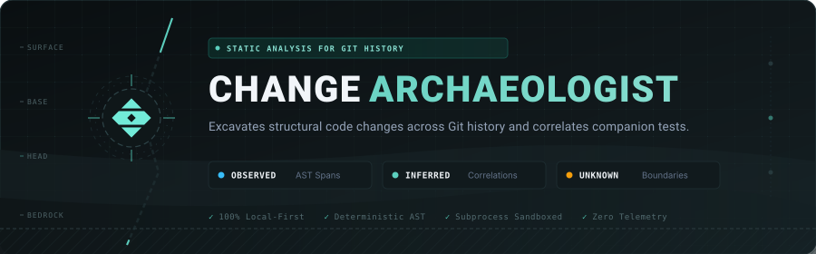
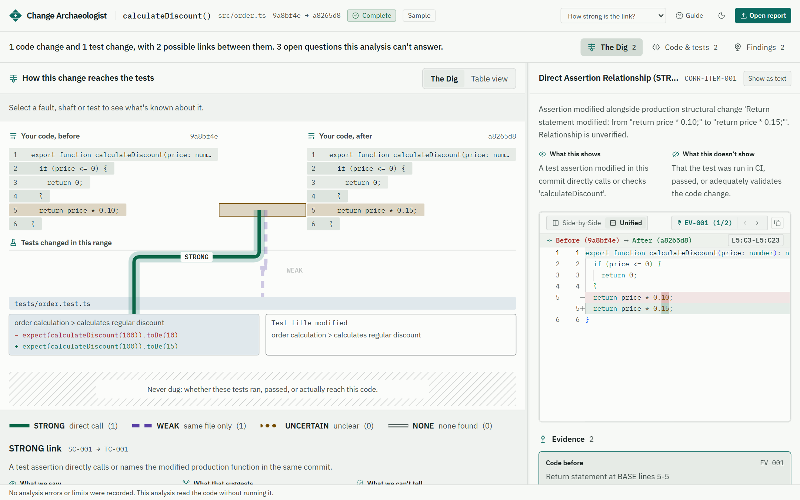
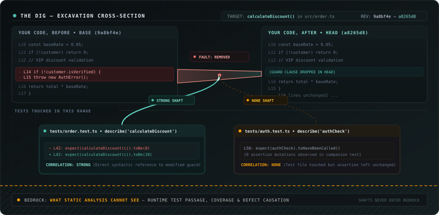
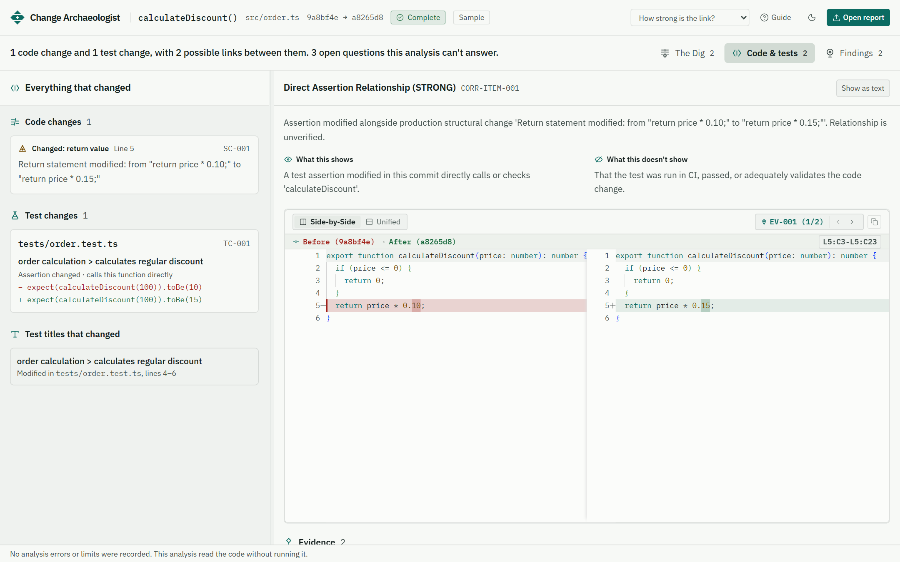
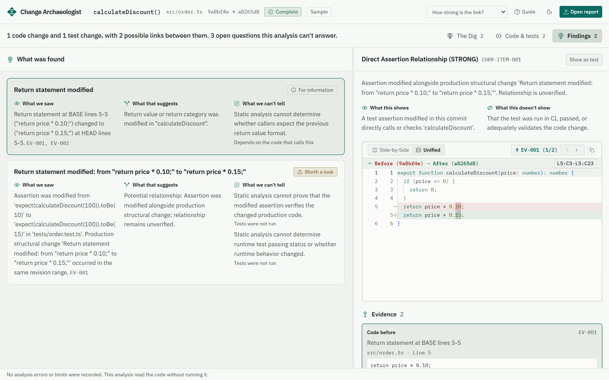
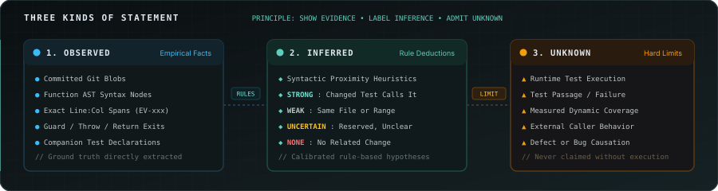
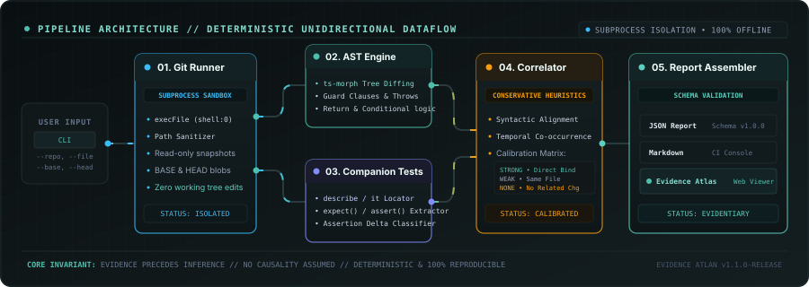
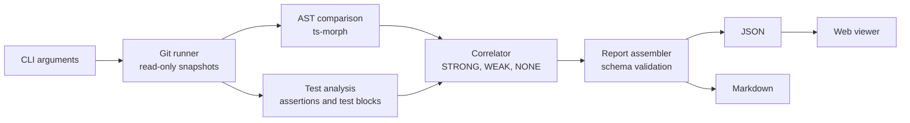

<div align="center">



<h3>See how a function changed between two Git versions,<br />and whether its tests moved with it.</h3>

<p>No AI. No running your code. Every claim traces back to a line in a commit.</p>

[](https://github.com/rknishanth152-lgtm/change-archaeologist/actions/workflows/ci.yml)
[](LICENSE)
[](package.json)
[](tsconfig.json)
[](#safety)

[Quick start](#quick-start) · [The viewer](#the-viewer) · [How to read a result](#how-to-read-a-result) · [Use it on your code](#use-it-on-your-code) · [When not to use it](#when-not-to-use-it) · [How it works](#how-it-works) · [Docs](docs/README.md)

</div>

<br />

<picture>
  <source media="(prefers-color-scheme: dark)" srcset="docs/assets/screens/dig-dark.png" />
  
</picture>

<p align="center"><sub>The Dig. Your code is the rock, each change is a fault, and each shaft is a possible link to a test. The hatched ground is what static analysis can't see.</sub></p>

## Why this exists

A return value changes from `price * 0.10` to `price * 0.15`. A test changes in the same commit. Did the tests really move with the code?

`git diff` shows you the lines. Coverage tells you what ran. Neither one connects a specific change in a function to a specific assertion, and an AI summary can do it only by guessing.

Change Archaeologist reads both versions of the function as syntax trees, finds the guards, conditions, throws and returns that changed, and looks for matching changes in your tests. Then it separates **what it saw** from **what that suggests** and **what it can't know**.

> **Show the evidence. Label the inference. Admit what is unknown.**

## Quick start

You need Node.js 20 or newer, and Git on your `PATH`.

```bash
git clone https://github.com/rknishanth152-lgtm/change-archaeologist.git
cd change-archaeologist
npm install
npm run demo
```

`npm run demo` builds a small Git repository with fixed commits, analyzes six kinds of change, and checks every result against recorded expectations:

```console
[Scenario D] ✓ PASS: Companion Test Change Detection
  Function: calculateDiscount in src/order.ts
  Status:   COMPLETED_WITH_FINDINGS (Exit: 0)

[Scenario F] ✓ PASS: Unknown or Incomplete Evidence (Missing Function)
  Function: deprecatedHelper in src/legacy.ts
  Status:   INCOMPLETE_FUNCTION_MISSING (Exit: 1)

DEMONSTRATION RESULTS: 6 / 6 Scenarios Passed
```

Reports land in `examples/output/`. To explore them visually:

```bash
npm run dev
```

Open <http://localhost:5173>, then choose a sample or drop in one of the `.json` reports.

## The viewer

Reports are read in your browser and never leave your computer. Light and dark themes are built in.

### The Dig

Follow a change from your code down to your tests. Select a fault, a shaft or a test, and everything unrelated fades away. A full table view gives keyboard and screen-reader users the same content.



### Code & tests

Every change and test edit sits beside a real diff, side by side or in one column, with each piece of evidence one click away.

<picture>
  <source media="(prefers-color-scheme: dark)" srcset="docs/assets/screens/code-dark.png" />
  
</picture>

### Findings

Each finding says what was seen, what that suggests, and what can't be told, ordered by how much attention it deserves.

<picture>
  <source media="(prefers-color-scheme: dark)" srcset="docs/assets/screens/findings-dark.png" />
  
</picture>

## How to read a result

Every statement in a report is one of three kinds, and the schema enforces it. An observation must cite evidence, an inference must cite observations, and every finding must admit at least one unknown. A report that breaks these rules is rejected.



Links between code and tests are deliberately cautious:

| Status | What it means | In The Dig |
| :-- | :-- | :-- |
| `STRONG` | A changed assertion sits in a test block that calls the function directly. | Solid shaft |
| `WEAK` | The test file changed or mentions the function, but nothing points at this exact change. | Broken shaft |
| `UNCERTAIN` | Reserved in the report format for unclear evidence. The current rules don't produce it. | Dotted shaft |
| `NONE` | No related test change was found. | Hollow shaft ending in open ground |

Even `STRONG` doesn't mean the test ran, passed, or covers the change. It means the syntax lines up.

## Use it on your code

Analyze one function between two revisions. Name the test files you want compared.

```bash
node bin/change-archaeologist.js analyze \
  --repo ./my-app \
  --file src/order.ts \
  --function calculateDiscount \
  --base v1.0.0 \
  --head v1.1.0 \
  --test-file tests/order.test.ts \
  --format json \
  --output report.json
```

Open `report.json` in the viewer, or leave out `--format` and `--output` to print a Markdown report:

```markdown
#### [CORR-ITEM-001] POTENTIALLY_RELATED_ASSERTION_MODIFIED (Status: `STRONG`)

- **Observed Fact**: Assertion was modified from 'expect(calculateDiscount(100)).toBe(10)'
  to 'expect(calculateDiscount(100)).toBe(15)' in 'tests/order.test.ts'.
- **Inferred Relationship**: Assertion was modified alongside production structural
  change; relationship remains unverified.
- **Unknowns**:
  - Static analysis cannot prove that the modified assertion verifies the changed code.
  - Static analysis cannot determine runtime test passing status.
```

<details>
<summary><strong>All options</strong></summary>

| Option | Short | Description |
| :-- | :-: | :-- |
| `--repo <path>` | `-r` | Local Git repository. Required. |
| `--file <path>` | `-f` | Repository-relative source file. Required. |
| `--function <name>` | `-fn` | Function or method to analyze. Required. |
| `--base <revision>` | `-b` | Older commit, branch or tag. Required. |
| `--head <revision>` | | Newer commit, branch or tag. Required. |
| `--test-file <path>` | `-t` | Test file to compare. Repeat it or separate with commas. |
| `--format <type>` | | `markdown` (default) or `json`. |
| `--output <path>` | `-o` | Write to a file instead of stdout. |
| `--force` | | Overwrite an existing output file. |
| `--debug` | | Show detailed error information. |
| `--help` / `--version` | `-h` / `-v` | Print help or the version. |

</details>

### Exit codes for scripts and CI

| Code | Meaning |
| :-: | :-- |
| `0` | Analysis completed and the report is valid. |
| `1` | Analysis was incomplete, for example the function is missing from one version. A partial report is still written. |
| `2` | Missing or malformed arguments. |
| `3` | Repository or revision not found or invalid. |
| `4` | Internal analysis failure. |
| `5` | The report couldn't be written. |

Exit code `0` means the analysis worked. It says nothing about whether the change is safe.

## Six patterns it's tested against



Each scenario also lists phrases its report must never contain, such as "proves a regression". If the tool ever overclaims, `npm run demo` fails.

## When to use it, and how it compares

Reach for it when you're reviewing a risky change, working out what happened during an incident, or checking whether a refactor changed a function's behavior-shaping logic.

| | Answers | Can't tell you |
| :-- | :-- | :-- |
| `git diff` | Which lines changed | Whether a change is structural or just reformatting |
| Coverage tools | Which lines ran during tests | Whether a test asserts anything about a change |
| AI code review | A plausible summary | Why it believes that, deterministically |
| **Change Archaeologist** | Which guards, conditions, throws and returns changed, and which test edits may relate | Whether any test ran, passed, or caught a bug |

### When not to use it

- **You need to know if tests pass or what they cover.** It never runs your code. Use your test runner and a coverage tool.
- **You want a whole-repository scan.** It analyzes one named function at a time, across two revisions.
- **Your code isn't JavaScript or TypeScript.** Those are the only languages it parses.
- **You expect test files to be found for you.** Name them with `--test-file`. Without any, no test comparison happens.

## How it works

The pipeline runs in one direction, and the engine in `src/core` has no UI or network code.



<details>
<summary><strong>See the data flow</strong></summary>



</details>

### Safety

- **It never changes your repository.** It reads committed objects with read-only Git commands. Your working tree, index and refs stay as they were.
- **No shell.** Git runs through `execFile` with `shell: false` and argument arrays. Revisions starting with `-` are rejected, and `--end-of-options` guards the rest.
- **Paths are checked.** Absolute paths, traversal, drive letters, UNC paths and null bytes are refused.
- **Resource limits.** Source files over 2 MB are refused, Git output is capped at 10 MB, Git commands time out after 15 seconds, and the viewer refuses reports over 20 MB.
- **Careful writing.** Reports are written atomically, never inside `.git`, and never over an existing file unless you pass `--force`.
- **No network.** No telemetry and no external APIs. Fonts and editor workers ship with the app.

### Project layout

```text
├── bin/            CLI launcher
├── src/
│   ├── core/       Analysis engine: git, ast, comparison, test-analysis,
│   │               correlation, reporting, domain
│   ├── cli/        Argument parsing, orchestration, safe file output
│   └── viewer/     React web viewer
├── tests/          Unit, integration and early proof-of-concept tests
├── validation/     Corpus of real-world change scenarios
├── scripts/        Demo repository builder and runner
├── examples/       Expected demo results
├── public/         Static viewer assets
└── docs/           Guides, architecture, reports and design system
```

## Development

```bash
npm run typecheck   # Strict TypeScript check
npm test            # Unit, integration and validation suites
npm run build       # CLI and viewer production builds
npm run demo        # Build, then verify all six scenarios
npm run dev         # Viewer with hot reload
```

CI runs all of these except `dev` on Windows and Linux. Contributions are welcome. Please keep these three rules:

1. Never style correlation as causation, or missing evidence as proof of absence.
2. Keep Git access free of shell strings and unchecked paths.
3. Keep it local: no feature may need a network connection or an API key.

Changes to analysis or correlation rules need deterministic tests.

## Learn more

[Demo guide](docs/guides/demo-guide.md) · [Design system](docs/DESIGN.md) · [Architecture blueprint](docs/architecture/blueprint.md) · [Security report](docs/reports/security-and-cross-platform-report.md) · [All documentation](docs/README.md)

## License

[MIT](LICENSE)
